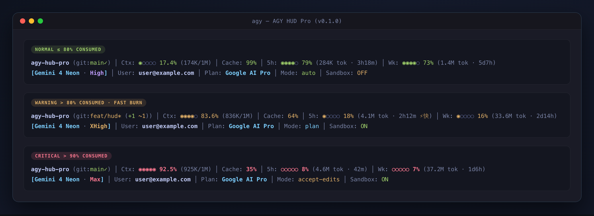

# agy-hub-pro (AGY HUD Pro)

[](https://github.com/bangbangda/agy-hub-pro/releases)
[](https://github.com/bangbangda/agy-hub-pro/actions/workflows/ci.yml)
[](./LICENSE)
[](#)
[](#)

**English** | [简体中文](./README.zh-CN.md)

A lightweight, zero-dependency **Antigravity CLI (`agy`)** two-line StatusLine dashboard and lifecycle hooks plugin built with native Node.js ESM for millisecond startup and zero terminal input lag.

## Preview



```text
agy-hub-pro (git:main✓) │ Ctx: ◉○○○○ 17.4% (174K/1M) │ Cache: 99% │ 5h: ◉◉◉◉○ 79% (289K tok · 3h18m) │ Wk: ◉◉◉◉○ 73% (1.4M tok · 5d7h)
[Gemini 4 Neon · High] │ User: user@example.com │ Plan: Google AI Pro │ Mode: auto │ Sandbox: OFF │ ● run_command 18s · ~56 t/s
```

## Features

- **Two-Line Telemetry Dashboard + Responsive Width Fitting**
  - **Line 1**: Workspace name & Git status (branch, ahead/behind `↑`/`↓`, uncommitted breakdown `+staged ~modified ?untracked` or `✓`), context window usage (`used/max`), Prompt Cache hit rate, 5-hour rolling window quota & token ledger with reset countdown and fast-burn indicator (`⚡快`), and weekly quota & token ledger with reset countdown.
  - **Line 2**: Full model name with reasoning effort (`Low` / `Medium` / `High` / `XHigh` / `Max`), account email, subscription plan tier, execution mode (`auto` / `plan` / `accept-edits`), sandbox status (`ON` / `OFF`), and a live activity & throughput indicator (`● run_command 18s · ~56 t/s` while working, turning yellow after 60s without progress; `~56 t/s` stays visible for the full terminal window lifecycle including across `/clear`).
  - Automatically adapts to `terminal_width` by trimming lower-priority fields so split panes never wrap awkwardly.
- **5-Dot Bullseye Progress Indicators & Threshold Coloring**
  - High-contrast bullseye dots (`◉`/`○`) by default: **Green** (`≤ 80%` consumed), **Yellow** (`> 80%` consumed), and **Red** (`> 90%` consumed), with synchronized colors for both dots and percentage figures.
  - Ships with 6 built-in styles switchable via `AGY_HUD_DOT_STYLE`: `bullseye` (default), `pill` (`▰▱`), `small` (`•◦`), `square` (`▪▫`), `diamond` (`◆◇`), and `classic` (`●○`).
- **Local Cache + Async Refresh + Lifecycle Hooks**
  - **Auto-Synced Local Ledger**: Persists incremental token usage across sessions into local `state.json` (aligned to active 5-hour and weekly quota reset cycles, falling back to rolling 5h / calendar week when reset times are unavailable, and auto-pruning entries older than 7 days), with atomic writes and zero external dependencies.
  - **`SessionStart`**: Cleans stale lock files and triggers a detached background initialization.
  - **`Stop`**: Accumulates per-turn token deltas and triggers a throttled background refresh.
  - **`PreInvocation`** (compatible with `UserPromptSubmit`): Injects a concise warning recommending `gemini-4-hydrogen` when 5h or weekly remaining quota drops below `15%`.
  - **Field Sniffing**: Dumps formatted `stdin` snapshots to `/tmp/agy-hud-last-stdin.json` for easy payload debugging.

## Quick Start

```bash
git clone https://github.com/bangbangda/agy-hub-pro.git ~/.gemini/plugins/agy-hud-pro
cd ~/.gemini/plugins/agy-hud-pro

# 1. Run built-in simulation tests & plugin validation (does not touch settings.json)
./install.sh --test

# 2. Install (backs up settings.json to settings.json.bak, configures statusLine & hooks)
./install.sh --install
```

### Enable Instantly in Your Current `agy` Session

```text
/statusline node ~/.gemini/plugins/agy-hud-pro/statusline.mjs
```

### Pin Input & HUD to the Bottom (Optional)

Run `/settings` inside `agy` and set **Alt Screen Mode** to `always` (or add `"altScreenMode": "always"` to `~/.gemini/antigravity-cli/settings.json`) to keep the prompt composer and two-line HUD pinned at the bottom of your terminal.

## Environment Variables

| Variable | Default | Description |
| :--- | :--- | :--- |
| `AGY_HUD_DOT_STYLE` | `bullseye` | Progress glyph style: `bullseye` / `pill` / `small` / `square` / `diamond` / `classic` |
| `AGY_HUD_GIT_TIMEOUT_MS` | `150` | Timeout in ms for `git status` (falls back to direct `.git/HEAD` read on timeout) |
| `AGY_HUD_STALL_SEC` | `60` | Seconds without token or transcript step progress before the live activity indicator turns yellow |
| `AGY_HUD_SHOW_NON_GIT` | `0` | Set to `1` to display `git:-` in non-Git directories |
| `AGY_HUD_WARN_THRESHOLD` | `15` | Remaining quota % threshold for `PreInvocation` low-quota warnings |
| `AGY_HUD_5H_BUDGET` | `5000000` | Fallback 5-hour token budget used for local estimation (`~` prefix) |
| `AGY_HUD_WEEK_BUDGET` | `40000000` | Fallback weekly token budget used for local estimation (`~` prefix) |
| `NO_COLOR` | unset | Set to any non-empty value to disable ANSI colors |

## Project Structure

```text
agy-hub-pro/
├── plugin.json       # Native Antigravity plugin manifest
├── hooks.json        # Lifecycle hooks (SessionStart / PreInvocation / Stop)
├── statusline.mjs    # Millisecond two-line ANSI StatusLine renderer
├── collector.mjs     # Background quota prober & local token ledger maintainer
├── install.sh        # Permissions, backup-and-merge installer & simulation test suite
├── assets/
│   └── preview.png   # Terminal statusline preview image
├── LICENSE           # MIT License
├── README.md         # English documentation
└── README.zh-CN.md   # Chinese documentation
```

## License

This project is licensed under the [MIT License](./LICENSE).
