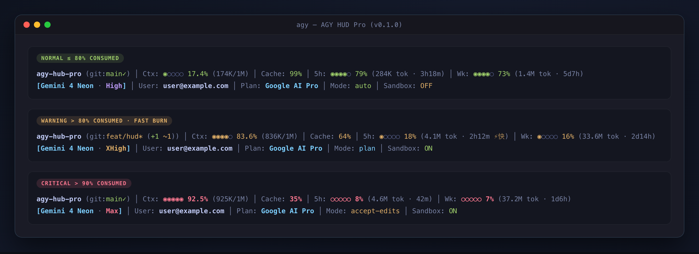

# agy-hub-pro (AGY HUD Pro)

[](https://github.com/bangbangda/agy-hub-pro/releases)
[](https://github.com/bangbangda/agy-hub-pro/actions/workflows/ci.yml)
[](./LICENSE)
[](#)
[](#)

[English](./README.md) | **简体中文**

轻量级、零外部 npm 依赖的 **Antigravity CLI (`agy`)** 双行底部状态栏（StatusLine）与生命周期钩子插件，基于 macOS 原生 Node.js ESM 构建，毫秒级同步渲染、输入零卡顿。

## 效果预览



```text
agy-hub-pro (git:main✓) │ Ctx: ◉○○○○ 17.4% (174K/1M) │ Cache: 99% │ 5h: ◉◉◉◉○ 79% (284K tok · 3h18m) │ Wk: ◉◉◉◉○ 73% (1.4M tok · 5d7h)
[Gemini 4 Neon · High] │ User: user@example.com │ Plan: Google AI Pro │ Mode: auto │ Sandbox: OFF
```

## 核心特性

- **双行信息看板 + 窄窗口自适应**：
  - **第一行**：项目目录与 Git 状态（分支名、远程同步 `↑`/`↓`、未提交变更明细 `+staged ~modified ?untracked` 或 `✓`）、Context 占用（`已用/总量`）、Prompt Cache 命中率、5h 窗口余量 / Token 消耗 / 重置倒计时 / 快速消耗预警（`⚡快`）、周配额余量 / Token 消耗 / 重置倒计时。
  - **第二行**：完整模型名与思考强度（`Low`/`Medium`/`High`/`XHigh`/`Max`）、账号邮箱、订阅套餐、执行模式（`auto`/`plan`/`accept-edits`）、沙箱状态（`ON`/`OFF`），以及工作中的实时活跃与速率指示（如 `● run_command 18s · ~56 t/s`，超过 60 秒无进展自动变黄提醒，空闲时自动收敛为上轮速率 `~56 t/s`）。
  - 依据 `terminal_width` 自动裁剪次要字段，分屏变窄不折行。
- **5 格靶心圆点进度条 + 三色预警**：
  - 默认采用高对比度靶心圆点（`◉`/`○`），消耗 `≤80%` 绿色、`>80%` 黄色、`>90%` 红色，圆点与百分比数字同色。
  - 内置 6 套样式，可通过环境变量 `AGY_HUD_DOT_STYLE` 随时切换：`bullseye`（默认）、`pill`（`▰▱`）、`small`（`•◦`）、`square`（`▪▫`）、`diamond`（`◆◇`）、`classic`（`●○`）。
- **本地缓存 + 异步刷新 + 生命周期钩子**：
  - **内置本地账本自动同步**：无需钩子也可跨会话按 5 小时与周配额重置周期持久化累计 Token（无云端重置时间时自动回退至滑动 5h / 自然周，自动清理 >7 天过期记录），原子写入零损坏。
  - `SessionStart`：清理过期锁文件并异步触发后台初始化。
  - `Stop`：累加本轮增量 Token 并节流异步刷新配额缓存。
  - `PreInvocation`（兼容 `UserPromptSubmit`）：当 5h 或周余量 `< 15%` 时注入系统提醒，建议切换至 `gemini-4-hydrogen`。
  - 首次或调试运行时自动转储原始 `stdin` 至 `/tmp/agy-hud-last-stdin.json` 便于排查字段。

## 快速安装

```bash
git clone https://github.com/bangbangda/agy-hub-pro.git ~/.gemini/plugins/agy-hud-pro
cd ~/.gemini/plugins/agy-hud-pro

# 1. 运行模拟测试与插件结构校验（不修改真实 settings.json）
./install.sh --test

# 2. 一键安装（自动备份原 settings.json 为 settings.json.bak，并注册 statusLine 与生命周期钩子）
./install.sh --install
```

### 在当前 `agy` 会话中即时启用状态栏

```text
/statusline node ~/.gemini/plugins/agy-hud-pro/statusline.mjs
```

### 底部悬浮固定（可选）

在 `agy` 中运行 `/settings` 将 **Alt Screen Mode** 设为 `always`（或在 `~/.gemini/antigravity-cli/settings.json` 中设置 `"altScreenMode": "always"`），输入框与双行 HUD 将始终固定悬浮在终端最底部。

## 环境变量配置

| 变量 | 默认值 | 说明 |
| :--- | :--- | :--- |
| `AGY_HUD_DOT_STYLE` | `bullseye` | 进度样式：`bullseye` / `pill` / `small` / `square` / `diamond` / `classic` |
| `AGY_HUD_GIT_TIMEOUT_MS` | `150` | `git status` 超时阈值（毫秒），超时后自动回退读取 `.git/HEAD` |
| `AGY_HUD_STALL_SEC` | `60` | 工作中无 token 或步骤推进超过该秒数时，活跃指示灯变黄提醒 |
| `AGY_HUD_SHOW_NON_GIT` | `0` | 设为 `1` 时在非 Git 目录显示 `git:-` |
| `AGY_HUD_WARN_THRESHOLD` | `15` | `PreInvocation` 主动配额预警阈值（%） |
| `AGY_HUD_5H_BUDGET` | `5000000` | 无云端配额时的 5h 本地估算基准（tokens） |
| `AGY_HUD_WEEK_BUDGET` | `40000000` | 无云端配额时的周本地估算基准（tokens） |
| `NO_COLOR` | 未设置 | 设为任意非空值时禁用 ANSI 颜色输出 |

## 项目结构

```text
agy-hub-pro/
├── plugin.json       # Antigravity 原生插件清单
├── hooks.json        # 生命周期钩子配置 (SessionStart / PreInvocation / Stop)
├── statusline.mjs    # 毫秒级双行 ANSI 状态栏渲染脚本
├── collector.mjs     # 后台异步配额探测与本地 Token 账本维护脚本
├── install.sh        # 一键权限设置、备份合并安装与全链路模拟测试脚本
├── assets/
│   └── preview.png   # 终端双行状态栏渲染效果图
├── LICENSE           # MIT 开源协议
├── README.md         # 英文文档
└── README.zh-CN.md   # 中文文档
```

## 开源协议

本项目基于 [MIT License](./LICENSE) 开源。
