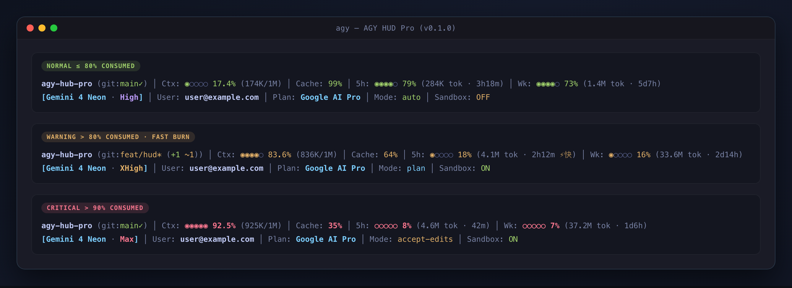

# agy-hub-pro (AGY Hub Pro)

[](https://github.com/bangbangda/agy-hub-pro/releases)
[](https://github.com/bangbangda/agy-hub-pro/actions/workflows/ci.yml)
[](./LICENSE)
[](#隐私与安全声明)
[](#10-秒极速安装)

[English](./README.md) | **简体中文**

轻量级、**零外部依赖**、自包含的 **Antigravity CLI (`agy`)** 双行底部状态栏（StatusLine HUD）与生命周期钩子插件。基于原生 Node.js ESM（仅使用 `node:*` 内置模块）构建，毫秒级同步渲染、无损深度合并配置、终端输入零卡顿。



```text
agy-hub-pro (git:main✓) │ Ctx: ◉○○○○ 17.4% (174K/1M) │ Tok: 1.4M │ Cache: 99% │ 5h: ◉◉◉◉○ 79% (3h18m) │ Wk: ◉◉◉◉○ 73% (5d7h)
[Gemini 4 Neon · High] │ User: dev@example.com │ Plan: Google AI Pro │ Mode: auto │ Sandbox: OFF │ ● run_command 18s · ~56 t/s
```

---

## 10 秒极速安装

无需 `npm install` / `pnpm install`，无需任何构建步骤。只要本机有 Node.js `>= 18`，即可开箱即用。

### 方式一：单行远程脚本一键安装（推荐 — 全自动 HUD + 钩子）

自动拉取至 `~/.gemini/plugins/agy-hub-pro`，按优先级智能探测真实生效的配置文件（`~/.gemini/antigravity-cli/settings.json` 与 `~/.gemini/settings.json`，自动识别软链接），先生成带时间戳的备份（`settings.json.bak.YYYYMMDDHHMMSS`），再执行 **JSON 深度合并**，**绝对保留**你原有的 `mcpServers`、`trustedWorkspaces`、`permissions`、`model` 等配置，并自动注册生命周期钩子：

```bash
curl -fsSL https://raw.githubusercontent.com/bangbangda/agy-hub-pro/main/install.sh | bash
```

### 方式二：原生 `agy plugin install` 标准安装

直接使用 Antigravity 原生插件命令安装（自动识别根目录 `plugin.json` 与 `hooks.json`）：

```bash
agy plugin install bangbangda/agy-hub-pro
```

随后在当前 `agy` 会话中输入以下命令即时开启底部状态栏（或执行插件目录内的 `./install.sh --install` 自动写入 `settings.json`）：

```text
/statusline node ~/.gemini/plugins/agy-hub-pro/statusline.mjs
```

### 方式三：手动克隆并先预览再安装

```bash
git clone https://github.com/bangbangda/agy-hub-pro.git ~/.gemini/plugins/agy-hub-pro
cd ~/.gemini/plugins/agy-hub-pro

node statusline.mjs --test      # 终端直接预览 ANSI 效果（零磁盘写入）
./install.sh --install          # 备份并深度合并 settings.json 与 hooks
node statusline.mjs --doctor    # 运行全链路自检，确认全绿通过
```

### 可选：将输入框与双行 HUD 固定在终端底部

在 `agy` 中运行 `/settings`，将 **Alt Screen Mode** 设为 `always`（或在 `~/.gemini/antigravity-cli/settings.json` 中添加 `"altScreenMode": "always"`），输入框与双行 HUD 将始终悬浮固定在终端最底部。

### 一键无残留卸载

仅移除本插件注入的 `statusLine` 与生命周期钩子条目，写入前自动备份，**不会影响**任何其他自定义配置或第三方状态栏：

```bash
# 本地卸载
~/.gemini/plugins/agy-hub-pro/uninstall.sh          # 移除配置挂载与运行缓存
~/.gemini/plugins/agy-hub-pro/uninstall.sh --purge  # 同时删除插件安装目录

# 或通过单行脚本远程卸载
curl -fsSL https://raw.githubusercontent.com/bangbangda/agy-hub-pro/main/uninstall.sh | bash
```

---

## 完整字段与图标说明

AGY Hub Pro 采用双行紧凑布局，并根据 `terminal_width` 自动按优先级裁剪次要字段，分屏变窄也不会错位折行。

### 第一行 — 项目目录、Git、上下文、净消耗、缓存命中与配额

| 字段 | 示例 | 说明 |
| :--- | :--- | :--- |
| **项目与 Git 状态** | `agy-hub-pro (git:main✓)` | 当前工作区目录名与 Git 分支。绿色 `✓` 表示干净工作区；黄色 `*` 表示有未提交变更。 |
| **远程同步箭头** | `↑2↓1` | 领先上游分支提交数（青色 `↑`）与落后提交数（洋红 `↓`）。 |
| **变更明细** | `(+2 ~3 ?1)` | `+N` 已暂存（绿）、`~N` 已修改（黄）、`?N` 未跟踪（灰）。若大仓库 `git status` 超时，自动回退直读 `.git/HEAD` 并显示 `…`。 |
| **Context 窗口** | `Ctx: ◉○○○○ 17.4% (174K/1M)` | 5 格进度条 + 上下文已用百分比 + `已用/上限` Token 紧凑计数。 |
| **当前会话净消耗** | `Tok: 1.4M` | 基于 `transcript.jsonl` 精确增量统计的当前会话净消耗（`input + output`，不含缓存读取）。 |
| **Prompt Cache** | `Cache: 99%` | 本轮 Prompt Cache 缓存命中率。`≥70%` 绿、`40–69%` 黄、`<40%` 红。 |
| **5 小时滚动配额** | `5h: ◉◉◉◉○ 79% (3h18m)` | 5h 剩余配额百分比 + 重置倒计时。 |
| **快速消耗预警** | `⚡快` | 当 5h 余量 `<70%` 且消耗速率超过当前窗口流逝进度的 `1.25×` 时自动点亮。 |
| **周配额窗口** | `Wk: ◉◉◉◉○ 73% (5d7h)` | 周剩余配额百分比 + 重置倒计时。 |
| **本地估算标记** | `~92%` | 当无云端实时配额数据时，自动基于本地 7 天 Token 账本推算余量并加 `~` 前缀提示。 |

### 第二行 — 模型、思考强度、账号、套餐、模式与实时活跃状态

| 字段 | 示例 | 说明 |
| :--- | :--- | :--- |
| **模型与思考强度** | `[Gemini 4 Neon · High]` | 当前完整模型名与推理强度徽章（`Off`/`Min`/`Low`/`Medium`/`High`/`XHigh`/`Max`）。 |
| **账号信息** | `User: dev@example.com` | 当前登录的 `agy` 账号邮箱/用户名（终端变窄时优先裁剪）。 |
| **订阅套餐** | `Plan: Google AI Pro` | 订阅等级按颜色区分（Ultra/Max 黄色、Pro/Team 青色、Free 灰色）。 |
| **执行模式** | `Mode: auto` | 当前代理执行模式（`auto` 绿、`plan` 青、`accept-edits` 黄）。 |
| **沙箱状态** | `Sandbox: OFF` | 终端沙箱开启状态（`ON` 绿、`OFF` 黄）。 |
| **实时状态与速率** | `● run_command 18s · ~56 t/s` | 工作态实时圆点（正常绿、超过 `60s` 无进展变黄提示卡顿）、当前工具动作/思考中、耗时计时与输出吞吐速率（同一终端窗口内跨 `/clear` 持久保留）。 |

### 5 格进度条三色阈值与内置样式

| 消耗比例 | 颜色 | 对应规则 |
| :--- | :--- | :--- |
| `≤ 80%` | 绿色 | `Ctx` 已用 `≤80%`；`5h`/`Wk` 剩余 `≥20%` |
| `> 80%` | 黄色预警 | `Ctx` 已用 `>80%`；`5h`/`Wk` 剩余 `<20%` |
| `> 90%` | 红色危急 | `Ctx` 已用 `>90%`；`5h`/`Wk` 剩余 `<10%` |

通过环境变量 `AGY_HUB_DOT_STYLE` 可切换 6 套内置进度图标：
- `bullseye`（默认）：`◉◉◉○○`
- `pill`：`▰▰▰▱▱`
- `small`：`•••◦◦`
- `square`：`▪▪▪▫▫`
- `diamond`：`◆◆◆◇◇`
- `classic`：`●●●○○`

### 生命周期钩子（`hooks.json`）

- **`SessionStart`**：清理过期锁文件，异步派生后台初始化进程（非阻塞）。
- **`Stop`**：按轮次累加增量 Token 至本地 7 天滚动账本，并自动清理过期历史记录。
- **`PreInvocation`**：当 5h 或周余量 `< 15%` 时自动注入系统提醒，建议切换至高性价比模型 `/model gemini-4-hydrogen`。

---

## 隐私与安全声明

- **100% 本地运行**：全部逻辑仅依赖本机原生 Node.js 内置模块（`node:fs`、`node:os`、`node:path`、`node:child_process`、`node:url`）。
- **零数据上报、零网络请求**：`statusline.mjs` 与 `collector.mjs` 不发起任何 HTTP/网络调用，不收集任何遥测、提示词或代码内容。
- **零第三方依赖**：不包含任何 `node_modules` 或外部 npm 包，彻底杜绝供应链风险与安装报错。
- **绝不接触凭据**：不读取、不复制、不打印任何 OAuth Token 或 API Key。
- **数据集中隔离存储**：运行态文件（`state.json`、`collector.lock`、`last-stdin.json`）统一存放在 `~/.gemini/plugins/agy-hub-pro/data/`（若无写权限则自动降级至系统临时目录），原子写入防损坏，超过 7 天自动清理。

---

## `--doctor` 与 `--test` 自检排查指南

任何时候都可以在终端运行内置预览与诊断命令：

```bash
# 注入模拟会话 JSON，在终端即时预览 3 种色阶与窄窗口裁剪效果（不写盘）
node ~/.gemini/plugins/agy-hub-pro/statusline.mjs --test

# 运行全面自检：Node.js 版本、Git、配置文件挂载、软链接与缓存目录权限
node ~/.gemini/plugins/agy-hub-pro/statusline.mjs --doctor

# 输出 JSON 格式诊断报告（便于脚本或 CI 校验）
node ~/.gemini/plugins/agy-hub-pro/statusline.mjs --doctor --json
```

### 常见诊断项与修复建议

| 检查项 | 诊断内容 | 出现 `WARN` / `FAIL` 时的处理方式 |
| :--- | :--- | :--- |
| **Node.js Runtime** | 检查 Node.js 版本是否 `>= 18.0.0` | 升级 Node.js（如 `brew install node` 或 `nvm install 22`）。 |
| **Plugin Integrity** | 校验 `plugin.json` / `hooks.json` 合法性及脚本可执行权限 | 执行 `chmod +x statusline.mjs collector.mjs install.sh uninstall.sh`。 |
| **Git Command** | 检查 `git` 命令可用性与响应耗时 | 安装 Git（macOS 运行 `xcode-select --install`）；即使缺失，状态栏也会自动回退直读 `.git/HEAD`。 |
| **Settings & StatusLine Mount** | 自动探测 `~/.gemini/antigravity-cli/settings.json` 与 `~/.gemini/settings.json`（精准识别软链接与多文件冲突），校验 `statusLine.command` 挂载路径 | 运行 `~/.gemini/plugins/agy-hub-pro/install.sh --install`，或在 `agy` 内运行 `/statusline node ~/.gemini/plugins/agy-hub-pro/statusline.mjs`。 |
| **Lifecycle Hooks** | 检查原生插件钩子或 `~/.gemini/config/hooks.json`，检测新旧 `agy-hud-pro` 重复注册 | 重新运行 `./install.sh --install` 自动迁移并清理旧版重复钩子。 |
| **Data & Cache Directory** | 对 `~/.gemini/plugins/agy-hub-pro/data/` 执行真实读写删探针，并检测 `state.json` 与过期锁 | 修复目录权限：`mkdir -p ~/.gemini/plugins/agy-hub-pro/data && chmod 755 ~/.gemini/plugins/agy-hub-pro/data`。 |

> **提示**：若 `agy` 曾因连续异常触发熔断提示（`⚠ Statusline disabled after 30 consecutive failures`），先运行 `--doctor` 修复标红项，再在 `agy` 中输入 `/statusline enable` 即可恢复渲染。

---

## 环境变量配置

所有 `AGY_HUB_*` 变量同时兼容旧版 `AGY_HUD_*` 别名。

| 变量 | 默认值 | 说明 |
| :--- | :--- | :--- |
| `AGY_HUB_DOT_STYLE` | `bullseye` | 进度样式：`bullseye` / `pill` / `small` / `square` / `diamond` / `classic` |
| `AGY_HUB_DATA_DIR` | `~/.gemini/plugins/agy-hub-pro/data` | 自定义状态账本、锁文件与嗅探快照存储目录 |
| `AGY_HUB_GIT_TIMEOUT_MS` | `150` | `git status` 超时阈值（毫秒），超时后自动回退读取 `.git/HEAD` |
| `AGY_HUB_STALL_SEC` | `60` | 无 Token 增长或步骤推进超过该秒数时，活跃圆点变黄提示卡顿 |
| `AGY_HUB_SHOW_NON_GIT` | `0` | 设为 `1` 时在非 Git 目录显示 `(git:-)` |
| `AGY_HUB_WARN_THRESHOLD` | `15` | `PreInvocation` 主动配额预警阈值（%） |
| `AGY_HUB_5H_BUDGET` | `5000000` | 无云端配额时的 5h 本地估算基准（tokens） |
| `AGY_HUB_WEEK_BUDGET` | `40000000` | 无云端配额时的周本地估算基准（tokens） |
| `AGY_HUB_SNIFF` | `1` | 设为 `0` 时关闭 `data/last-stdin.json` 原始负载转储 |
| `NO_COLOR` | 未设置 | 设为任意非空值时禁用 ANSI 颜色输出 |

---

## 项目结构

```text
agy-hub-pro/
├── plugin.json       # Antigravity 原生插件清单
├── hooks.json        # 根目录生命周期钩子 (SessionStart / PreInvocation / Stop)
├── assets/
│   ├── logo.svg      # 插件矢量图标
│   └── preview.png   # 终端状态栏效果预览图
├── statusline.mjs    # 毫秒级双行 ANSI 状态栏渲染器 + --test / --doctor 自检入口
├── collector.mjs     # 后台异步配额探测与 7 天本地 Token 账本维护脚本
├── install.sh        # 远程/本地一键安装器（自动探测、安全深合并、时间戳备份与测试套件）
├── uninstall.sh      # 一键无残留卸载脚本（保留所有其他用户配置）
├── LICENSE           # MIT 开源许可证
├── README.md         # 英文主文档
└── README_CN.md      # 简体中文文档
```

## 开源协议

本项目基于 [MIT License](./LICENSE) 开源。
